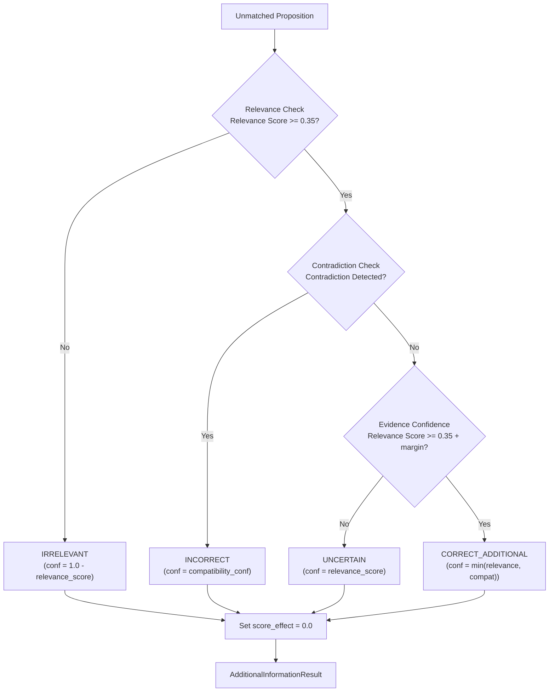

# Stage 13 Report: Additional-Information Classification

**Implementation Date:** Stage 13 of the ASAG Research Pipeline  
**Repository:** proposition-level-asag  
**Research Stage:** STAGE 13 — Additional-Information Classification  

---

## 1. Research Hypothesis & Context

The overarching research question of this project is:
> *"Can an interpretable proposition-level extension of a classical semantic/dependency-based ASAG system evaluate unmatched student information as correct additional, irrelevant, or incorrect information, and does incorporating this evaluation improve agreement with human grading?"*

> **IMPORTANT RESEARCH PRINCIPLE**:
> The proposed proposition-level extension is a **RESEARCH HYPOTHESIS**.
> We do NOT claim that this classification extension improves grading, achieves superior human agreement, or outperforms baselines until actual experimental evaluations (Stage 15) demonstrate it.
> Stage 13 implements the interpretability and classification logic; it does not evaluate empirical grading performance.

In classical semantic/dependency-based ASAG (e.g. Basak et al., 2019), scoring is strictly a measure of **reference proposition coverage**:
- Does the student answer entail the propositions in the reference answer?
- If yes, points are awarded.
- If the student writes additional propositions not found in the reference answer, they are left unmatched and ignored (`score_effect = 0.0`).

Stage 13 operationalizes the research hypothesis by introducing an **interpretable classification engine** for these unmatched student propositions, categorizing them into:
1. `CORRECT_ADDITIONAL`: Content that is semantically relevant to the question/topic, consistent with reference propositions, and introduces valid supplementary facts/constraints.
2. `IRRELEVANT`: Content that shows insufficient semantic connection to the question topic or reference domain.
3. `INCORRECT`: Content that contradicts the reference answer (via polarity opposition, lexical antonymy, or conflicting qualification properties).
4. `UNCERTAIN`: An internal fallback category for propositions with borderline semantic evidence, preventing forced binary decisions in the absence of domain knowledge.

---

## 2. Stage 13 Objectives

1. **Structured Input Boundary**: Consume the rich Stage 12 `PropositionRepresentation` and `DocumentPropositionRepresentation` instances.
2. **Two-Dimensional Evaluation Framework**:
   - **Dimension 1: Question Relevance**: Evaluate semantic relatedness of unmatched propositions to the prompt question and reference domain.
   - **Dimension 2: Reference Compatibility**: Evaluate whether relevant propositions support, introduce non-conflicting additions, or directly contradict reference propositions.
3. **Transparent Evidence Model**: Construct structured evidence containers (`RelevanceEvidence`, `CompatibilityEvidence`) preserving exact semantic similarity scores, matched lexical terms, and diagnostic rationales.
4. **Conservation of Research Invariants**:
   - **Strict Score Invariance**: Every classified unmatched proposition has `score_effect = 0.0`.
   - **Base ASAG Score Invariance**: `base_asag_normalized_score` is preserved exactly as computed in Stage 10.
   - **Matched Proposition Preservation**: Matched propositions are preserved with `classification = "MATCHED_BY_BASE_ASAG"`.
5. **Deterministic, Rule-Based, and Interpretable**: Avoid black-box machine learning, deep embeddings, sentence transformers, and LLM prompting.
6. **Pure JSON Serialization**: Provide complete `.to_dict()` and `.to_json()` methods with zero leakage of internal runtime/parse objects.

---

## 3. Scope & Non-Goals

| Component | In Stage 13 Scope? | Details / Rationale |
|---|---|---|
| Unmatched Proposition Classification | **YES** | Categorize into `CORRECT_ADDITIONAL`, `IRRELEVANT`, `INCORRECT`, `UNCERTAIN`. |
| Question Relevance Analysis | **YES** | Multi-slot lexical/WordNet semantic overlap against question/reference terms. |
| Contradiction & Antonym Analysis | **YES** | Polarity clash detection, WordNet antonymy, qualification conflict. |
| Evidence Preservation | **YES** | `RelevanceEvidence`, `CompatibilityEvidence` with human-readable rationales. |
| Score Modification | **NO** | `score_effect = 0.0` strictly enforced. No bonus or penalty. |
| Proposed ASAG Scoring | **NO** | Reserved strictly for Stage 14 (`proposed_asag/scoring/`). |
| Machine Learning / LLMs | **NO** | No SVM, Random Forest, PyTorch, Sentence-Transformers, or LLM prompting. |
| Hardcoded Answer Strings | **NO** | Rules operate purely on semantic similarities, polarities, slots, and synsets. |

---

## 4. Theoretical Foundation & Literature Grounding

### Paper Fact vs Implementation Extension

- **PAPER FACT (Basak et al., 2019)**:
  Basak et al. evaluate short answers using dependency parse triples, semantic similarity (WordNet path similarity, synonymy), and rule-based textual entailment. Their scoring model is solely based on reference triple entailment. Any triple in the student answer that is not aligned to the reference triple is simply ignored.

- **OUR IMPLEMENTATION DECISION / PROPOSED EXTENSION (System 3)**:
  We propose that unmatched student propositions contain valuable diagnostic signals that human graders take into account. Rather than ignoring them, our proposed pipeline extracts their structural and linguistic representation (Stage 12) and classifies their semantic role relative to the question and reference answer (Stage 13).

- **CRITICAL DISTINCTION: Absence of Support vs Contradiction**:
  A common error in naive ASAG systems is to treat unmatched propositions as automatically incorrect (`UNMATCHED == INCORRECT`). In this project, we formally distinguish between:
  - `reference_support == "NOT_SUPPORTED"`: The proposition introduces information outside the reference answer. If it is relevant and non-contradictory, it may represent `CORRECT_ADDITIONAL` information.
  - `contradiction_status == "CONTRADICTION_DETECTED"`: The proposition explicitly opposes a reference claim or qualification, qualifying it as `INCORRECT`.

---

## 5. Architecture & Data Structures

The Stage 13 module is located in `proposed_asag/classification/`:
- `proposed_asag/classification/additional_info.py`: Core analyzers, classifiers, and data containers.
- `proposed_asag/classification/__init__.py`: Package interface.

```
Stage 10: BaseASAGPipelineResult
      ↓
Stage 11: PropositionAlignmentResult
      ↓
Stage 12: DocumentPropositionRepresentation / PropositionRepresentation
      ↓
Stage 13: AdditionalInformationClassifier
      ├── RelevanceAnalyzer ──> RelevanceEvidence
      ├── CompatibilityAnalyzer ──> CompatibilityEvidence
      └── DocumentClassificationResult
            ├── unmatched_classifications: List[AdditionalInformationResult] (score_effect = 0.0)
            ├── matched_propositions: List[Dict] (classification = "MATCHED_BY_BASE_ASAG")
            └── base_asag_normalized_score (preserved unchanged)
```

### Core Data Models

#### 1. `RelevanceEvidence`
Encapsulates topical relatedness:
- `is_relevant: bool`: True if relevance score meets or exceeds `relevance_threshold` (default 0.35).
- `score: float`: Continuous composite score in `[0.0, 1.0]`.
- `relevance_threshold: float`: Threshold applied (default 0.35).
- `matched_question_terms: List[str]`: Question content lemmas with similarity >= 0.50.
- `matched_reference_terms: List[str]`: Reference content lemmas with similarity >= 0.50.
- `method: str`: `"semantic_overlap"`, `"insufficient_overlap"`, or `"empty_terms"`.
- `reasons: List[str]`: Explainable decision rationale.
- `details: Dict[str, Any]`: Breakdown of `max_overlap`, `mean_overlap`, and individual term similarities.

#### 2. `CompatibilityEvidence`
Encapsulates reference consistency and contradiction analysis:
- `reference_support: str`: `"NOT_SUPPORTED"` or `"CONTRADICTED"`.
- `contradiction_status: str`: `"NO_CONTRADICTION"`, `"CONTRADICTION_DETECTED"`, or `"UNCERTAIN"`.
- `contradiction_type: Optional[str]`: `"POLARITY_CONTRADICTION"`, `"ANTONYM_CONTRADICTION"`, `"MODIFIER_CONFLICT"`, or `None`.
- `conflicting_reference_index: Optional[int]`: Index of the conflicting reference proposition.
- `conflicting_reference_relation: Optional[Dict[str, Any]]`: Dependency relation dictionary of the conflicting reference proposition.
- `confidence: float`: Confidence score in `[0.0, 1.0]`.
- `reasons: List[str]`: Detailed diagnostic reasons.
- `details: Dict[str, Any]`: Diagnostic slot evidence and candidate alignment scores.

#### 3. `AdditionalInformationResult`
Classification record for a single unmatched proposition:
- `proposition_id`: Unique string ID (e.g. `"stu_prop_1"`).
- `proposition_index`: Zero-based integer index.
- `text`: Surface text span.
- `classification`: `"CORRECT_ADDITIONAL"`, `"IRRELEVANT"`, `"INCORRECT"`, or `"UNCERTAIN"`.
- `confidence`: Bounded continuous confidence score.
- `relevance`: `RelevanceEvidence` instance.
- `compatibility`: `CompatibilityEvidence` instance.
- `decision_reason`: Human-readable summary explanation.
- `score_effect`: Strictly `0.0`.
- `span`, `relation`, `polarity`: Linkage to Stage 11/12 structures.

#### 4. `DocumentClassificationResult`
Complete document-level container:
- Preserves `base_asag_normalized_score` unchanged.
- Aggregates counts: `matched_count`, `unmatched_count`, `correct_additional_count`, `irrelevant_count`, `incorrect_count`, `uncertain_count`.
- `unmatched_classifications`: List of `AdditionalInformationResult`.
- `matched_propositions`: Preserved matched propositions with `classification = "MATCHED_BY_BASE_ASAG"`.
- `all_propositions`: Complete, ordered list of all evaluated student propositions.
- `summary`: High-level summary metrics.

---

## 6. Relevance Analysis Methodology (`RelevanceAnalyzer`)

The `RelevanceAnalyzer` evaluates whether an unmatched proposition pertains to the core topic of the question and reference answer.

### Term Extraction
1. **Proposition Terms**: Extracted from relation slots (`subject`, `predicate`, `object`, and lemmas), argument modifiers (`subject_modifiers`, `object_modifiers`, `adverbial_modifiers`), and prepositional arguments. Functional stopwords (e.g. `is`, `was`, `can`, `it`, `and`, `the`) are filtered out.
2. **Context Terms**: Content lemmas (nouns, verbs, adjectives) extracted from `context.question` and `context.reference_answer`.

### Multi-Tier Similarity with POS Fallback
When comparing surface terms `w1` and `w2`:
- Level 1: Exact surface equality (`sim = 1.0`).
- Level 2: Lemma equality (`sim = 1.0`).
- Level 3: POS compatibility.
- Level 4: WordNet path similarity.
If explicit POS tags are not available, the analyzer tests candidate content POS tags (`NOUN`, `VERB`, `ADJ`) to capture path similarity between valid content words (e.g. `convert` <-> `translate` = 0.333, `entry` <-> `record` = 0.333, `file` <-> `record` = 0.50).

### Composite Relevance Formulation
Let:
- $\text{max\_overlap} = \max_{t \in P} \max(\text{sim}(t, Q), \text{sim}(t, R))$
- $\text{mean\_overlap} = \frac{1}{|P|} \sum_{t \in P} \max(\text{sim}(t, Q), \text{sim}(t, R))$
- $\text{topic\_score} = \max(\text{sim}(\text{subj}, Q \cup R), \text{max\_overlap})$

$$\text{Relevance Score} = 0.50 \cdot \text{topic\_score} + 0.30 \cdot \text{max\_overlap} + 0.20 \cdot \text{mean\_overlap}$$

If $\text{Relevance Score} \ge \text{relevance\_threshold}$ (default 0.35), the proposition is deemed relevant.

---

## 7. Compatibility & Contradiction Methodology (`CompatibilityAnalyzer`)

The `CompatibilityAnalyzer` inspects whether a relevant proposition contradicts the instructor's reference answer using three complementary mechanisms:

### 1. Polarity Opposition on Structurally Aligned Relations
If an unmatched proposition had a high candidate alignment score ($\ge \text{contradiction\_threshold}$, default 0.50) against a reference proposition in Stage 7/11, but the polarities clash:
- Student proposition is `NEGATED` while reference is `POSITIVE` (or vice versa).
- **Result**: `contradiction_status = "CONTRADICTION_DETECTED"`, `contradiction_type = "POLARITY_CONTRADICTION"`.
- *Example*: Student says *"A primary key uniquely identifies records. It does not identify records."* Candidate alignment = 0.697; student is negated $\rightarrow$ `INCORRECT`.

### 2. Lexical Antonymy on Shared Subject Slots
If the student proposition shares its subject with a reference proposition ($\text{sim} \ge 0.50$), but the predicate or object is an explicit WordNet antonym:
- *Example*: Reference states *"The policy allows access"*, student states *"The policy forbids access"*.
- `allow` and `forbid` are WordNet antonyms.
- **Result**: `contradiction_status = "CONTRADICTION_DETECTED"`, `contradiction_type = "ANTONYM_CONTRADICTION"`.

### 3. Property Qualification Conflict on Shared Entity
Academic definitions frequently use qualifying adverbs/adjectives to specify uniqueness, exclusivity, or validity. The analyzer evaluates generalized opposition clusters:
- Uniqueness vs Duplication/Multiplicity: $\{\text{unique}, \text{uniquely}, \text{single}\} \leftrightarrow \{\text{duplicate}, \text{multiple}, \text{repeated}\}$
- Allowance vs Prohibition: $\{\text{allow}, \text{permit}\} \leftrightarrow \{\text{forbid}, \text{prevent}, \text{disallow}\}$
- Validity vs Invalidity: $\{\text{valid}, \text{correct}\} \leftrightarrow \{\text{invalid}, \text{incorrect}\}$

If the reference requires uniqueness (`uniquely`) and the student asserts duplication (`duplicate`) on that entity:
- If asserted in **positive polarity** (*"can contain duplicate values"*): Direct conflict $\rightarrow$ `INCORRECT` (`MODIFIER_CONFLICT`).
- If asserted in **negated polarity** (*"cannot contain duplicate values"*): Consistent with uniqueness $\rightarrow$ No contradiction!

---

## 8. Classification Decision Logic & Uncertainty Fallback

For each unmatched proposition, the `AdditionalInformationClassifier` executes a deterministic three-step decision flow:



### The `UNCERTAIN` Category
The `UNCERTAIN` classification serves as an essential scientific safeguard:
- Classical NLP lacks external encyclopedic world knowledge.
- If a student makes an assertion that is marginally related and not directly contradicted by the reference answer, forcing a choice between `CORRECT_ADDITIONAL` and `INCORRECT` would introduce unjustified classification bias.
- The `UNCERTAIN` classification transparently documents that available lexical-semantic evidence is insufficient to verify correctness or error.

---

## 9. Walkthrough on Key Demonstration Cases

We evaluate the classifier across the benchmark cases established in Section 7 of `GEMINI.md`:

### Case 1: Student A (Standard Paraphrase)
- **Question**: *"What is the purpose of a primary key?"*
- **Reference**: *"A primary key uniquely identifies each record in a table."*
- **Student A**: *"A primary key uniquely identifies every row in a table."*
- **Evaluation**:
  - Matched count: 1 (`key | identifies | row` matched to reference `key | identifies | record`)
  - Unmatched count: 0
  - Unmatched classifications: `[]`
  - Base score: Preserved (0.50 or 1.0 depending on exact slot alignment)

### Case 2: Student B (Correct Additional Information)
- **Student B**: *"A primary key uniquely identifies each record in a table and cannot contain NULL values."*
- **Extracted Propositions**:
  - Prop 0 (MATCHED): `key | identifies | record` (`classification = "MATCHED_BY_BASE_ASAG"`, `score_effect = 1.0`)
  - Prop 1 (UNMATCHED): `cannot contain NULL values`, `polarity = NEGATED`, rel = `key | contain | values`, mod = `['NULL']`
- **Stage 13 Evaluation of Prop 1**:
  - Relevance: Subject `key` matches question `key` (similarity 1.0). Relevance score = 0.8667 $\ge$ 0.35 $\rightarrow$ Relevant.
  - Compatibility: No polarity clash, no antonym, `reference_support = "NOT_SUPPORTED"`, `contradiction_status = "NO_CONTRADICTION"`.
  - Decision: **`CORRECT_ADDITIONAL`** (confidence: 0.75, **`score_effect = 0.0`**).
  - Rationale: *"Proposition is classified as CORRECT_ADDITIONAL: semantically relevant to the topic, consistent with reference answer propositions, and introduces valid supplementary information."*

### Case 3: Student C (Incorrect Additional Information)
- **Student C**: *"A primary key uniquely identifies each record in a table and can contain duplicate values."*
- **Extracted Propositions**:
  - Prop 0 (MATCHED): `key | identifies | record` (`classification = "MATCHED_BY_BASE_ASAG"`, `score_effect = 1.0`)
  - Prop 1 (UNMATCHED): `can contain duplicate values`, `polarity = POSITIVE`, rel = `key | contain | values`, mod = `['duplicate']`
- **Stage 13 Evaluation of Prop 1**:
  - Relevance: Subject `key` matches question `key` (similarity 1.0). Relevance score = 0.8667 $\rightarrow$ Relevant.
  - Compatibility: Reference states `uniquely identifies`. Student asserts `duplicate` values in positive polarity on the same entity.
  - Contradiction detected: `MODIFIER_CONFLICT` (uniqueness vs duplication).
  - Decision: **`INCORRECT`** (confidence: 0.80, **`score_effect = 0.0`**).
  - Rationale: *"Property qualification conflict: student asserts 'duplicate' (positive polarity), which opposes reference qualification 'uniquely'."*

### Case 4: Student D (Irrelevant Additional Information)
- **Student D**: *"A primary key uniquely identifies each record in a table. SQL was developed in the 1970s."*
- **Extracted Propositions**:
  - Prop 0 (MATCHED): `key | identifies | record` (`classification = "MATCHED_BY_BASE_ASAG"`, `score_effect = 1.0`)
  - Prop 1 (UNMATCHED): `SQL was developed in 1970s`, rel = `SQL | developed | None`
- **Stage 13 Evaluation of Prop 1**:
  - Relevance: Terms `{SQL, develop, 1970}` compared against question `{purpose, primary, key}` and reference concepts.
  - Semantic overlap: Max similarity = 0.000, composite relevance score = 0.0000 < 0.35.
  - Decision: **`IRRELEVANT`** (confidence: 1.00, **`score_effect = 0.0`**).
  - Rationale: *"Proposition is classified as IRRELEVANT: semantic relevance score (0.0000) is below relevance threshold (0.35)."*

### Case 5: Negated Core Claim (Explicit Polarity Contradiction)
- **Answer**: *"A primary key uniquely identifies each record in a table. It does not identify records."*
- **Extracted Propositions**:
  - Prop 0 (MATCHED): `key | identifies | record`
  - Prop 1 (UNMATCHED): `It does not identify records`, `polarity = NEGATED`
- **Stage 13 Evaluation of Prop 1**:
  - Candidate alignment score = 0.697 against `key | identifies | record`.
  - Polarity opposition: Student is `NEGATED`, reference is `POSITIVE`.
  - Decision: **`INCORRECT`** (confidence: 0.697, `contradiction_type = "POLARITY_CONTRADICTION"`, **`score_effect = 0.0`**).

---

## 10. Preservation of Research Invariants

Across all evaluated cases, the following research invariants are guaranteed and tested:
1. **`score_effect = 0.0`**: Every classified unmatched proposition has `score_effect == 0.0`.
2. **Base ASAG Score Integrity**: `doc_cls.base_asag_normalized_score == pipe_res.normalized_score`.
3. **`proposed_score_effect_total = 0.0`**: The total score effect of proposed additional classifications is exactly 0.0.
4. **Matched Proposition Preservation**: Matched propositions retain their Base ASAG classification (`MATCHED_BY_BASE_ASAG`) and their Base ASAG score contribution.

---

## 11. Test Suite & Verification Results

A dedicated test suite was implemented in `tests/test_stage13_classification.py`, comprising 18 comprehensive tests:

| Test Name | Purpose | Result |
|---|---|---|
| `test_correct_additional_primary_key_student_b` | Verifies Student B unmatched clause $\rightarrow$ `CORRECT_ADDITIONAL` | **PASSED** |
| `test_irrelevant_additional_sql_student_d` | Verifies Student D historical clause $\rightarrow$ `IRRELEVANT` | **PASSED** |
| `test_incorrect_additional_duplicates_student_c` | Verifies Student C duplicate clause $\rightarrow$ `INCORRECT` (`MODIFIER_CONFLICT`) | **PASSED** |
| `test_explicit_polarity_contradiction` | Verifies negated claim on candidate $\rightarrow$ `INCORRECT` (`POLARITY_CONTRADICTION`) | **PASSED** |
| `test_not_supported_distinct_from_incorrect` | Asserts `reference_support == "NOT_SUPPORTED"` does not imply `INCORRECT` | **PASSED** |
| `test_uncertain_fallback_borderline_evidence` | Verifies borderline semantic evidence triggers `UNCERTAIN` fallback | **PASSED** |
| `test_multiple_unmatched_propositions_independent` | Evaluates multi-unmatched document (correct + irrelevant) independently | **PASSED** |
| `test_matched_propositions_preserved` | Verifies matched propositions retain `MATCHED_BY_BASE_ASAG` and score | **PASSED** |
| `test_student_a_no_unmatched` | Verifies clean handling when 0 unmatched propositions exist | **PASSED** |
| `test_base_asag_score_strictly_unchanged` | Asserts exact equivalence between Base ASAG score and Stage 13 container | **PASSED** |
| `test_exact_proposition_id_linkage` | Verifies `proposition_id` and `proposition_index` linkage to Stage 12 | **PASSED** |
| `test_json_serializability` | Tests `.to_json()` and round-trip `json.loads()` validation | **PASSED** |
| `test_wordnet_antonym_contradiction` | Tests explicit WordNet antonymy (`allow` vs `forbid`) $\rightarrow$ `INCORRECT` | **PASSED** |
| `test_deterministic_classification` | Asserts identical output across consecutive runs | **PASSED** |
| `test_document_summary_metrics` | Validates category count aggregation in `summary` dictionary | **PASSED** |
| `test_custom_relevance_threshold` | Tests parameter configurability under strict threshold | **PASSED** |
| `test_classify_document_with_doc_rep_input` | Verifies direct ingestion of `DocumentPropositionRepresentation` | **PASSED** |
| `test_all_propositions_structure_and_ordering` | Verifies ordered unified list containing both matched and unmatched | **PASSED** |

### Test Execution Summary
- **Stage 13 Suite**: 18 passed in 4.02s
- **Full Repository Suite**: 249 passed in 8.21s (0 failures, 0 regressions across Stages 1–13)

---

## 12. Sample JSON Output

```json
{
  "student_answer": "A primary key uniquely identifies each record in a table and cannot contain NULL values.",
  "question": "What is the purpose of a primary key?",
  "reference_answer": "A primary key uniquely identifies each record in a table.",
  "base_asag_normalized_score": 1.0,
  "total_student_propositions": 2,
  "matched_count": 1,
  "unmatched_count": 1,
  "correct_additional_count": 1,
  "irrelevant_count": 0,
  "incorrect_count": 0,
  "uncertain_count": 0,
  "unmatched_classifications": [
    {
      "proposition_id": "stu_prop_1",
      "proposition_index": 1,
      "text": "cannot contain NULL values",
      "classification": "CORRECT_ADDITIONAL",
      "confidence": 0.75,
      "relevance": {
        "is_relevant": true,
        "score": 0.8667,
        "relevance_threshold": 0.35,
        "matched_question_terms": ["key", "primary"],
        "matched_reference_terms": ["key", "primary", "table"],
        "method": "semantic_overlap",
        "reasons": [
          "Proposition demonstrates topic relevance (relevance score: 0.8667 >= threshold: 0.35)."
        ]
      },
      "compatibility": {
        "reference_support": "NOT_SUPPORTED",
        "contradiction_status": "NO_CONTRADICTION",
        "contradiction_type": null,
        "conflicting_reference_index": null,
        "confidence": 0.75,
        "reasons": [
          "No contradiction detected with reference propositions.",
          "Proposition asserts supplementary information not directly covered by reference answer (NOT_SUPPORTED)."
        ]
      },
      "decision_reason": "Proposition is classified as CORRECT_ADDITIONAL: semantically relevant to the topic, consistent with reference answer propositions, and introduces valid supplementary information.",
      "score_effect": 0.0
    }
  ],
  "summary": {
    "total_propositions": 2,
    "matched_count": 1,
    "unmatched_count": 1,
    "correct_additional_count": 1,
    "irrelevant_count": 0,
    "incorrect_count": 0,
    "uncertain_count": 0,
    "base_asag_normalized_score": 1.0,
    "proposed_score_effect_total": 0.0
  }
}
```

---

## 13. Assumptions & Methodological Decisions

1. **Topical Grounding Priority**:
   If an unmatched proposition shares its grammatical subject with the question topic (e.g. `key` matching `primary key`), it receives a substantial topic grounding weight. This models the linguistic phenomenon where anaphoric or coordinate clauses continue discussing the primary topic.
2. **Flexible POS Fallback for WordNet**:
   When comparing arbitrary content tokens from text (e.g. adverbs or noun phrases), WordNet queries require a valid POS tag (`NOUN`, `VERB`, `ADJ`, `ADV`). The analyzer falls back across candidate content categories if no explicit tag is provided, preventing false zeros on related terms like `convert` <-> `translate`.
3. **Conservative Contradiction Confirmation**:
   Contradiction requires either:
   - Polarity opposition on a relation with alignment $\ge 0.50$.
   - Explicit lexical antonymy verified in WordNet lemmas.
   - Polar property opposition on a shared entity.
   Absent these criteria, the system defaults to `NOT_SUPPORTED` rather than hallucinating an error.
4. **Score Decoupling**:
   Classification logic is completely decoupled from grade modification. The decision of whether `CORRECT_ADDITIONAL` should yield a bonus or whether `INCORRECT` should induce a deduction belongs exclusively to Stage 14 scoring policies.

---

## 14. Limitations & Edge Cases

1. **Domain-Specific World Knowledge**:
   WordNet is a general-domain lexical database. Domain-specific database or programming concepts (e.g. foreign keys, referential integrity, normalization) that lack paths in WordNet can only be assessed via topical overlap or fall back to `UNCERTAIN`.
2. **Complex Multi-Clause Anaphora**:
   If a student answer uses complex pronoun chains spanning several sentences (e.g. *"It was created... Later, that was revised..."*), the proposition extractor may represent the subject as a pronoun (`it`, `that`), resulting in lower topical grounding unless coreference resolution is applied.
3. **Nuanced Misconceptions**:
   A student statement that is grammatically positive and topical, but represents a subtle domain misconception not covered by direct antonymy or uniqueness qualifications, will be conservatively classified as `UNCERTAIN` or `CORRECT_ADDITIONAL` rather than `INCORRECT`. This is an honest reflection of unsupervised classical NLP limitations.

---

## 15. Relationship to Subsequent Stages

Stage 13 completes the classification extension (System 3). The remaining pipeline stages are:
- **Stage 14: Proposed Grading Mechanism**: Design explicit, configurable scoring policies that map `CORRECT_ADDITIONAL`, `IRRELEVANT`, and `INCORRECT` classifications into grade adjustments (bonuses, neutral treatment, penalties) alongside the Base ASAG score.
- **Stage 15: Evaluation Against Human Grades**: Empirically evaluate System 1 (TF-IDF), System 2 (Base ASAG), and System 3 (Proposed ASAG) on public ASAG benchmark datasets with human grades.
- **Stage 16: Qualitative Error Analysis**: Conduct structured error analysis to understand when proposition-level classification succeeds and fails.
- **Stage 17: Research Conclusions**: Conclude with an evidence-based answer to the research question.

---

## 16. Readiness for Stage 14

Stage 13 is fully implemented, thoroughly documented, and verified with 18 unit tests and 249 passing tests across the entire repository. The pipeline is now ready for **Stage 14: Proposed Grading Mechanism**.
